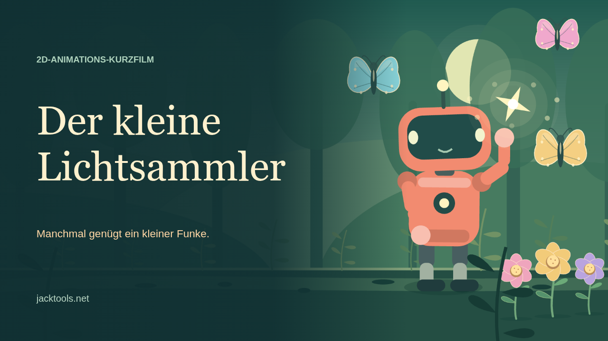
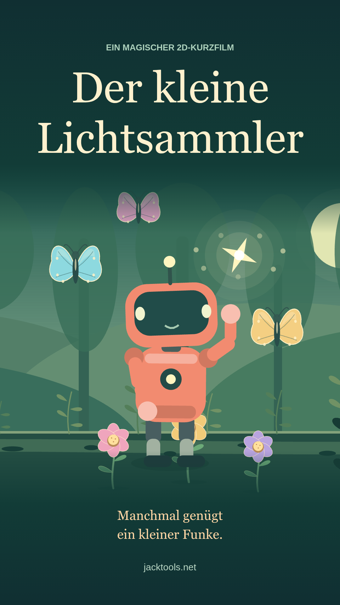

# Der kleine Lichtsammler

## Kurzbeschreibung

Ein Roboter verwandelt einen Lichtstern in Schmetterlinge: ein magischer 2D-Animations-Kurzfilm mit Musik, Blumen und kleinen Wundern.

## YouTube-Beschreibung inklusive Hashtags

Der kleine Lichtsammler: ein magischer 2D-Animations-Kurzfilm über einen neugierigen Roboter, einen leuchtenden Stern und drei bunte Schmetterlinge.

Auf einem stillen Waldweg entdeckt der kleine Roboter einen Lichtfunken. Eine mutige Berührung lässt den Stern in goldenen Lichtpartikeln aufgehen – und schenkt drei Schmetterlingen das Leben. Sie fliegen zu den Blumen, deren Blüten sanft nachschwingen. Im leuchtenden Nachtgarten bleibt eine einfache Botschaft: Manchmal genügt ein kleiner Funke.

Die 22-sekündige 2D-Animation verbindet liebevolle Figuren, sanfte Musik und feine Soundeffekte zu einer fantasievollen Kurzgeschichte für Kinder, Familien und Animationsfans.

Erstellt mit SceneScript und PixiJS. Mehr kreative Projekte: jacktools.net

#2DAnimation #Animationsfilm #Kurzfilm #Roboter #Schmetterlinge #Kinderfilm #Animationsgeschichte #SceneScript #JackTools

## YouTube: erster Kommentar

Manchmal genügt ein kleiner Funke. ✨ Welche kleine Begegnung hat Deinen Tag schon einmal heller gemacht? Schreib es in die Kommentare!

Was gefällt Dir am besten: der neugierige Roboter, die leuchtenden Schmetterlinge oder die tanzenden Blumen?

## YouTube-Tags (kommagetrennt, ohne #)

2D Animation, Animationsfilm, Kurzfilm, kleiner Roboter, Schmetterlinge, magische Geschichte, Kinderfilm, Familienfilm, SceneScript, PixiJS, jacktools.net

## YouTube-Cover (16:9)

1280 × 720 Pixel, PNG, 16:9. Aus den tatsächlichen 2D-Ressourcen komponiert; als Projekt-Cover eingebettet.

## TikTok-Caption inklusive Hashtags

Er berührt einen Stern … und plötzlich fliegen Schmetterlinge durch den Wald. ✨🦋 Ein kleiner Roboter, tanzende Blumen und 22 Sekunden Magie. Welcher Moment gefällt Dir am besten?

#2DAnimation #Kurzfilm #Roboter #Schmetterlinge #SceneScript

## TikTok: erster Kommentar

Team Lichtstern ✨ oder Team Schmetterling 🦋?

## TikTok-Cover (9:16)

1080 × 1920 Pixel, PNG. Separat herunterladen und manuell hochladen; das Filmformat bleibt unverändert.

Die Texte und Hashtags sind thematisch abgestimmt, garantieren aber keine Suchplatzierungen oder Reichweite. Es wurde nichts veröffentlicht.
